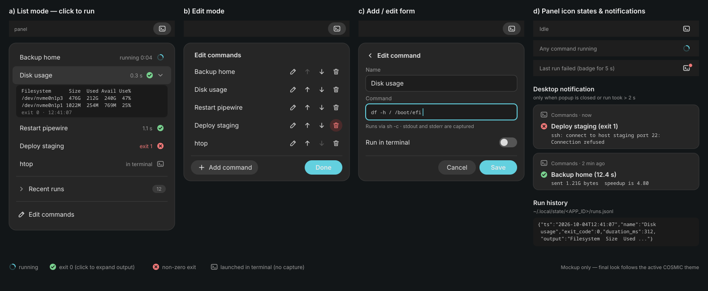

# COSMIC Commands Applet — Plan



*(PNG version: [docs/ui-mockup.png](docs/ui-mockup.png))*

## Context
The goal is a Pop!_OS COSMIC panel applet: a panel icon that opens a dropdown listing user-defined shell commands. Clicking an entry runs it and shows its status/output. Commands are added, edited and removed inside the popup and persisted via cosmic-config.

`/home/hoeggi/repos/popos-applet` is empty. The system runs Pop!_OS 24.04 with COSMIC (cosmic-panel 1.9, cosmic-applets 1.0.15). Rust, cargo and just are **not installed**, and the build toolchain will live in a container image (Podman by default, Docker supported) rather than on the host.

### How COSMIC applets work (research summary)
- **Process model:** An applet is a standalone Rust binary built on `libcosmic` with the `applet` feature. cosmic-panel launches it and embeds it as a Wayland surface. `cosmic::applet::run::<App>(flags)` starts it.
- **Discovery:** The panel finds applets through a `.desktop` file in `/usr/share/applications` with these keys:
  - `X-CosmicApplet=true`
  - `NoDisplay=true`
  - `Categories=COSMIC;`
  - optional: `X-CosmicHoverPopup=Auto`, `X-OverflowPriority=N`, `X-CosmicShrinkable=true`

  You add it in Settings → Desktop → Panel → Applets.
- **UI:** It uses the `cosmic::Application` trait (iced `Task`-based):
  - `view()` renders the panel button (`core.applet.icon_button(..)`).
  - `view_window(id)` renders the popup (`core.applet.popup_container(..)`).
  - Popups open via `get_popup(core.applet.get_popup_settings(..))` and close via `destroy_popup(id)`.
  - Menu rows use `cosmic::applet::menu_button` and `padded_control`.
  - `style()` returns `cosmic::applet::style()`.
- **Config:** A `#[derive(CosmicConfigEntry)] #[version = 1]` struct is stored per field as RON under `~/.config/cosmic/<APP_ID>/v1/<field>`. You watch it with `core.watch_config::<Config>(APP_ID)` and write it with the generated `set_<field>(&ctx, v)`.
- **Template:** Use the official `cargo generate gh:pop-os/cosmic-applet-template`. It provides `justfile`, `build.rs` (xdgen desktop file), `i18n/`, `resources/`, and `src/{main,app,config,i18n}.rs`. libcosmic MSRV is 1.93.
- **Prior art:** vinesnts/commands-applet (JSON config, nested menus, terminal option) and cosmic-ext-applet-executor are useful UI references.

## Design

**App ID:** `at.hoeggi.CosmicAppletCommands` (placeholder, can be renamed at generation time). The binary is named `cosmic-applet-commands`.

### Data model (`src/config.rs`)
```rust
#[derive(Clone, Debug, PartialEq, Serialize, Deserialize)]
pub struct CommandEntry { pub id: u64, pub name: String, pub command: String, pub in_terminal: bool }

#[derive(CosmicConfigEntry, Default, ...)] #[version = 1]
pub struct Config { pub commands: Vec<CommandEntry>, pub terminal: String /* default "cosmic-term" */ }
```
- **Initial state:** On first run the config is empty. The popup then shows "No commands — click Edit to add one".
- **Hand-editing:** Users can also edit `~/.config/cosmic/<APP_ID>/v1/commands` directly. The watcher picks up changes live.

### State (`src/app.rs`)
- **Core and config:** `core`, `popup: Option<Id>`, `config`, and `config_ctx: Option<cosmic_config::Config>`.
- **Mode:** `mode: Mode { List, Edit, Form(Option<u64> /* editing id or new */) }`.
- **Form fields:** `form_name`, `form_command`, `form_terminal`.
- **Run status:** `runs: HashMap<u64, RunState>` where `RunState { Running, Done { code: Option<i32>, output: String, at: Instant } }`.
- **Expanded output:** `expanded: Option<u64>`, which tracks the entry whose output is shown.

### Messages
- **Popup:** `TogglePopup`, `PopupClosed(Id)`
- **Running:** `Run(u64)`, `RunFinished(u64, Option<i32>, String)`, `ToggleOutput(u64)`
- **Editing:** `EnterEdit`, `ExitEdit`, `AddNew`, `EditEntry(u64)`, `Delete(u64)`, `MoveUp(u64)`, `MoveDown(u64)`
- **Form:** `FormName(String)`, `FormCommand(String)`, `FormTerminal(bool)`, `FormSave`, `FormCancel`
- **Config:** `ConfigChanged(Config)`

### Popup views
1. **List mode (default):**
   - One `menu_button` row per command. Each row shows the name plus a status indicator on the right: spinner text "…" while running, a ✓ or ✗ icon with the exit code when done.
   - Clicking a row runs the command. Clicking the status icon toggles an expandable block below the row showing the last ~20 lines of stdout/stderr in monospace `text`, inside a `scrollable` with max height.
   - Below the list: a divider, then a footer row with an "Edit commands" button.
2. **Edit mode:**
   - Each row shows the name plus icon buttons: edit (`document-edit-symbolic`), up, down, delete (`edit-delete-symbolic`).
   - Footer: "Add command" and "Done".
3. **Form mode:**
   - `text_input` fields for Name and Command, and a `toggler` for "Run in terminal".
   - Save and Cancel buttons. Save is disabled when either field is empty.
   - Note: text inputs in popups need keyboard focus. Set the popup settings' `grab: true` (the default) and verify typing works (see Risks).

### Execution
**Run(id):**
- Spawn the command asynchronously:
  ```rust
  Task::perform(async { tokio::process::Command::new("sh").arg("-c").arg(cmd).stdin(null).output().await }, |r| RunFinished(id, code, combined_output))
  ```
  Convert the result to `cosmic::Action::App`.
- Truncate the output to about 4 KB.
- Mark the entry `Running`, and ignore re-clicks while it is running.

**`in_terminal` commands:**
- These cannot capture output. Launch them detached with `cosmic::process::spawn(Command::new(terminal).args(["--", "sh", "-c", cmd]))`, which needs the libcosmic `process` feature.
- The status shows "launched in terminal".

**Popup behavior:**
- The popup stays open after clicking so the status is visible.
- The status persists in memory while the applet runs. It is not persisted to disk.

### Result display (all four channels)
1. **Inline in the popup:** a per-row status (running / ✓ / ✗ with exit code) and expandable output, as described above.
2. **Desktop notification:**
   - Sent through the `notify-rust` crate (freedesktop D-Bus; cosmic-notifications shows it).
   - Title: `✓ <name>` or `✗ <name> (exit N)`. Body: the first 3 lines of output.
   - Sent only when the popup is closed or the run took longer than 2 s, so it doesn't duplicate inline status the user is already looking at.
3. **Panel icon state:** `view()` picks the icon from aggregate state:
   - Idle: `utilities-terminal-symbolic`.
   - Any command running: `process-working-symbolic`.
   - Last run failed: `dialog-error-symbolic` for 5 s. A one-shot `Task` (tokio sleep) sends `ClearErrorBadge`.
4. **Run history:**
   - Each finished run is appended as one JSON line (`{ts, name, command, exit_code, duration_ms, output}`) to `$XDG_STATE_HOME/<APP_ID>/runs.jsonl`, defaulting to `~/.local/state/...`. When the file passes 1 MB it is truncated to the last 500 lines.
   - At startup the last 10 entries load into a ring buffer.
   - List mode gets a collapsible "Recent runs" section at the bottom. Rows show time, name and status; clicking one expands its output.

### Applet logs (diagnostics)
- **Where logs go:** cosmic-panel launches applets with stdout/stderr piped to the panel, which forwards them to the **user journal** under the `cosmic-panel` identifier, each line prefixed with the app ID (`at.hoeggi.CosmicAppletCommands: …`). Verified on this machine once the applet ran in the panel.
- **Logging setup:** Use `tracing` + `tracing-subscriber` (env-filter) writing to stderr, with the default level `info` overridable via `RUST_LOG`.
- **Viewing:**
  - Live logs: `journalctl --user -f -t cosmic-panel | grep at.hoeggi.CosmicAppletCommands:`.
  - With `make run`, logs print straight to the terminal.
  - A `make logs` target wraps the journalctl call.
- **What gets logged:** spawn, exit code and duration of each run, config load/write errors, and notification failures. Command output itself goes only to the run history, not the journal.

### Persistence
- **Writing:** Every edit (add, save, delete, reorder) mutates `self.config.commands` and calls `config.set_commands(&ctx, ...)`.
- **New ids:** New entries get an id from `max(id)+1`.
- **External changes:** `ConfigChanged` from `watch_config` replaces the in-memory list. Run entries for deleted ids are dropped.

### Files to create (after generating the template)
- `Cargo.toml`: add the libcosmic feature `process`. tokio comes from the template.
- `src/config.rs`: the data model above.
- `src/app.rs`: the applet. Split out `src/views.rs` if `app.rs` gets large.
- `resources/app.desktop`: add `X-CosmicApplet=true`, `NoDisplay=true`, `X-CosmicHoverPopup=Auto`, `X-OverflowPriority=10`, and `Icon=utilities-terminal-symbolic` (or a custom SVG in `resources/icon.svg`).
- `i18n/en/cosmic_applet_commands.ftl`: UI strings (Edit, Add command, Name, Command, Run in terminal, Save, Cancel, No commands…).

### Containerized build toolchain (nothing installed on the host)
**Engine:** Podman by default, with Docker supported too. Both are installed on the host (Podman 4.9.3, Docker 29.1).
- Podman is the default because it runs rootless and needs no daemon. With `--userns=keep-id`, files written into the repo stay owned by `hoeggi`, without UID/GID build args.
- Docker is the fallback: `make <target> ENGINE=docker`, using `--user $(id -u):$(id -g)` instead.
- Podman and Docker accept the same `build`/`run` arguments, so the build file and Makefile are shared.

- **`container/Containerfile`** (plain Dockerfile syntax; both engines read it via `-f`):
  - Base it on `ubuntu:24.04`, not `rust:*` (Debian). That gives the binary the same glibc as the host (2.39), so it runs natively on Pop!_OS.
  - apt packages: `curl build-essential pkg-config cmake git libxkbcommon-dev libwayland-dev libssl-dev`.
  - Install Rust stable (≥ 1.93) system-wide via rustup into `/opt/rust`:
    - set `RUSTUP_HOME=/opt/rust/rustup` and `CARGO_HOME=/opt/rust/cargo` during the build;
    - put `/opt/rust/cargo/bin` on `PATH`;
    - make it world-readable with `chmod -R a+rX`.
  - Then `cargo install just cargo-generate`.
  - No user is created in the image. The engine runs the container as the host user (see below), so the same image works for any UID.
- **`Makefile`** (host entry point; the template's justfile stays and runs inside the container):
  - `ENGINE ?= podman`. Engine-specific user flags:
    - podman: `--userns=keep-id`
    - docker: `--user $(shell id -u):$(shell id -g)`
  - `.image.stamp` depends on `container/Containerfile`. It runs `$(ENGINE) build -f container/Containerfile -t cosmic-applet-builder container/` and touches the stamp, so the image is rebuilt only when the Containerfile changes. Switching `ENGINE` needs a `make image` to build the image for that engine, since their image stores are separate.
  - `RUN` expands to:
    ```
    $(ENGINE) run --rm -it $(USERFLAGS) -v $(CURDIR):/src -w /src -e HOME=/tmp -e CARGO_HOME=/src/.cache/cargo cosmic-applet-builder
    ```
    - The cargo registry/git cache lives in the repo under `.cache/cargo`, which is gitignored.
    - This avoids named-volume permission quirks under rootless Podman and keeps caches across runs for both engines.
    - `target/` lives in the bind mount.
  - Targets (all depend on `.image.stamp`):
    - `generate`: cargo-generate the template into a temp dir and move it into the repo.
    - `build`: `just build-release`.
    - `check`: `cargo clippy` and `cargo fmt --check`.
    - `run`: build, then run `./target/release/cosmic-applet-commands` on the host.
    - `stage`: `just rootdir=/src/target/stage install`.
    - `install`: depends on `stage`, then `sudo cp -r target/stage/usr/. /usr/`.
    - `uninstall`: removes the installed files.
    - `shell`: an interactive shell in the container.
    - `clean`: removes the build output.
    - `reload-panel`: `killall cosmic-panel`.
    - `logs`: follow `cosmic-panel` in the user journal, filtered to the app ID.
    - `image`: force-rebuild the builder image for the current `ENGINE`.
  - `.PHONY` covers all the non-file targets. `.image.stamp` and `.cache/` go in `.gitignore`.
- **Running and installing on the host:**
  - The container only builds; the built binary runs natively on the host, so no Wayland forwarding into the container is needed.
  - `make install` is the only step that uses sudo on the host.
  - If the template's justfile lacks a `rootdir` variable, add one. The template uses `rootdir`/`prefix` variables.

## Implementation steps
1. Write `container/Containerfile` and the `Makefile`, then build the image with `make image` (Podman).
2. Run `make generate` (cargo-generate of `gh:pop-os/cosmic-applet-template` inside the container, output moved into the repo root), then `git init`.
3. Implement `config.rs`.
4. Implement list mode plus popup toggle plus Run with status. Test with `make run`.
5. Implement edit and form modes plus persistence.
6. Update the desktop file, icon and i18n.
7. Run `make install`, add the applet via Settings, and iterate.

## Verification
- **Standalone:** `make build` and `make check` are clean. `make run` opens the applet standalone so the popup UI can be checked. This also confirms there is no glibc mismatch.
- **Add commands:** In Edit mode, add `echo hello`, `false`, and `sleep 3; date`. Confirm the RON file appears at `~/.config/cosmic/<APP_ID>/v1/commands`.
- **Run commands:**
  - `echo hello` shows ✓ and the output "hello".
  - `false` shows ✗ with code 1.
  - `sleep 3; date` shows the running state, then the output.
- **Hand edit:** Edit the RON file by hand and confirm the popup updates live.
- **Edit actions:** Reorder, edit and delete entries, then confirm the changes persist across `killall cosmic-panel`.
- **Panel install:** `make install`, then add the applet in Settings → Desktop → Panel → Applets. Confirm the icon appears and the popup positions correctly on a horizontal and a vertical panel.
- **Terminal option:** A command with "Run in terminal" opens cosmic-term.
- **Notifications:** Close the popup and run `sleep 3; false` from a reopened popup. A ✗ notification appears, and the panel icon shows the error badge for 5 s.
- **History:** `runs.jsonl` gains an entry per run, and "Recent runs" survives an applet restart.
- **Logs:** `make logs` shows the spawn and exit lines in the user journal.

## Risks / notes
- **Keyboard input in popups:** Typing in `text_input` inside an applet popup should work with grab, since other applets such as network/Wi-Fi password entry do this. If it doesn't, fall back to a small separate settings window via `cosmic::app` multi-window.
- **Untracked processes:** Long-running commands keep running if the applet restarts, and their output is lost. That is acceptable for v1.
- **Panel restart:** After reinstalling the binary, remove and re-add the applet or run `killall cosmic-panel` to load the new build.
